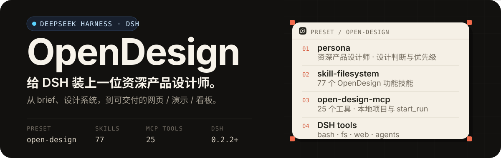
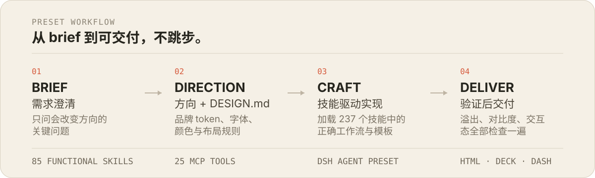

<p align="center">
  
</p>

<p align="center">
  <a href="https://github.com/deepseek-ai/deepseek-harness"></a>
  
  
  
  <a href="https://www.npmjs.com/package/dsh-open-design-preset"></a>
</p>

## 一个预设，把 DSH 变成设计工作室

OpenDesign 预设把 **DeepSeek Harness（DSH）** 变成一间设计工作室。它不是一段提示词，也不是把技能文件夹丢进目录：它把「资深产品设计师」的判断方式、OpenDesign 的 **77 个功能技能**、**152 套开源设计系统**，以及本地 OpenDesign 应用的 **MCP 工具**，组合进同一个可切换的预设。

选中它之后，DSH 会先澄清 brief，再锁定视觉方向与 `DESIGN.md`，加载正确的设计技能，最后按交付前检查清单产出**可运行的网页、演示、看板或动效**。

## 工作方式

<p align="center">
  
</p>

## 预设里有什么

| 层 | 作用 | 实际内容 |
| --- | --- | --- |
| `persona` | 设计人格与决策顺序 | 源自 OpenDesign Slim Core Charter 的资深产品设计师人设 |
| `skill-filesystem` | 设计工作流与设计系统 | **77 个**功能技能 + **152 个**设计系统技能，按需加载 |
| `open-design-mcp` | 与本地 OpenDesign 应用互通 | **25 个 MCP 工具**：项目/文件读取、`create_artifact`、`write_file`、`start_run` |
| `DSH tools` | 执行与交付 | `bash` / `pwsh`、文件读写、搜索、任务、子智能体、`present` |

## 快速开始

### 1. 安装 bundle

从 npm 安装：

```text
plugin_manager install_bundle target=dsh-open-design-preset@1.0.1
```

或从源码安装：

```text
git clone https://github.com/denceee/dsh-open-design-preset.git
cd dsh-open-design-preset
plugin_manager install_bundle target=<当前目录的绝对路径>
```

### 2. 新建会话并选择预设

打开 DSH，新建会话，在预设选择器中选择 **OpenDesign**。

### 3. 给一个设计 brief

```text
做一个面向投资人的 AI 财务分析仪表盘，深色界面，信息密度高，
带 3 个可切换视图和清晰的数据层级。
```

第一次使用会先问少量真正影响方向的问题；回答后先锁定视觉方向，再进入实现与交付检查。

## 技能库

**77 个功能技能**覆盖设计工作的主要路径，同时保留 DSH 全局技能（如 `frontend-design`、`docx` / `pdf` / `pptx`）的完整版本：

- **界面与原型** — `design-brief`、`web-design-guidelines`、`login-flow`、`mockup-device-3d`、`web-clone`
- **演示与文档** — `deck-swiss-international`、`deck-guizang-editorial`、`ppt-keynote`、`doc-kami-parchment`
- **动效与视频** — `motion-design`、`animate`、`gsap-*`、`video-hyperframes`
- **品牌与视觉** — `brand-extract`、`brandkit`、`impeccable-design-polish`
- **评审与交付** — `pr-feedback-quality-gate`、`review-animations`、`pptx-html-fidelity-audit`

技能来自 [`nexu-io/open-design`](https://github.com/nexu-io/open-design) 的 `skills/`。只收录自包含功能技能，剔除仅作目录索引的 stub 和与 DSH 全局技能重名的条目，因此 77 个都能直接执行，不会用空壳覆盖全局技能。

## 152 套 OpenDesign 设计系统

OpenDesign 把 150+ 套设计系统作为开源目录发布在 [`design-systems/`](https://github.com/nexu-io/open-design/tree/main/design-systems)（Apache-2.0）。预设把每一套都生成了一个独立 skill：

```text
open-design-airbnb
open-design-apple
open-design-linear-app
open-design-stripe
open-design-vercel
open-design-notion
open-design-material
open-design-x-ai
...
```

每份 skill 都包含对应系统的完整 `DESIGN.md`：palette、typography、spacing、components、do/don't 和视觉语气。选中 OpenDesign 预设后，模型会按 brief 自动匹配技能；也可以直接点名：

```text
用 open-design-linear-app 的设计系统做一个项目管理仪表盘。
```

设计系统来自本地 OpenDesign 应用目录。安装后执行一次生成脚本：

```powershell
node scripts/generate-design-system-skills.mjs
```

脚本默认读取 `D:\Open Design\resources\open-design\design-systems`；也可以指定目录：

```powershell
$env:OD_DESIGN_SYSTEMS_DIR = "C:\path\to\design-systems"
node scripts/generate-design-system-skills.mjs
```

生成的 152 个 skill 写入 `~/.dsh/open-design/design-system-skills`。预设通过 `skill-filesystem` 的两个 `customSkillDirs` 同时加载功能技能与设计系统技能；设计系统文档较长，预设的 tool-result pruner 已放宽到 64K 字符，保证整份 `DESIGN.md` 能完整进入上下文。

## 刷新技能库

完整上游 checkout 位于 `~/.dsh/open-design/repo`（sparse checkout，只包含 `skills/`）。GitHub 直连不稳定时，可以用 gh-proxy：

```powershell
git -C "$env:USERPROFILE\.dsh\open-design\repo" remote set-url origin https://gh-proxy.org/https://github.com/nexu-io/open-design.git
git -C "$env:USERPROFILE\.dsh\open-design\repo" pull --ff-only
```

重新按 `~/.dsh/open-design/SOURCE.json` 中的筛选规则复制到 `~/.dsh/open-design/skills` 即可，无需重启 DSH。设计系统目录单独位于 `~/.dsh/open-design/repo-design-systems`，可用同一脚本重新生成。

## 兼容性

- **DSH**：`0.2.2-rc.1`（通过 `@deepseek-ai/dsh-agent-preset` 原生声明）
- **OpenDesign**：本机测试版本 `0.26.1`；MCP 工具需要 OpenDesign daemon 在 `127.0.0.1:7456` 运行
- **不装 OpenDesign 也能用**：persona、77 个功能技能和 152 个设计系统技能仍然可用；MCP 工具会提示 daemon 不可达

## 文件结构

```text
.
├── cordis.patch.yml               # preset 声明与插件组合
├── package.json                   # DSH bundle 清单
├── scripts/
│   └── generate-design-system-skills.mjs  # 152 套设计系统 → DSH skills
├── assets/readme/
│   ├── hero.svg                   # 首屏视觉
│   ├── workflow.svg               # 工作流示意
│   └── badge-*.svg                # DSH / preset / skills / MCP 徽章
└── README.md
```

## 来源与许可

- OpenDesign 预设源：[`nexu-io/open-design`](https://github.com/nexu-io/open-design) · Apache-2.0
- 功能技能来源：`skills/` · commit `59e4f2ae85de7e7318a5e6bdcf3a34584c4b7582`
- 设计系统来源：[`design-systems/`](https://github.com/nexu-io/open-design/tree/main/design-systems) · 152 套 · Apache-2.0
- 品牌相关设计系统是审美参考，不是对应品牌的官方资产
- 本地技能目录：`~/.dsh/open-design/skills` 与 `~/.dsh/open-design/design-system-skills`
